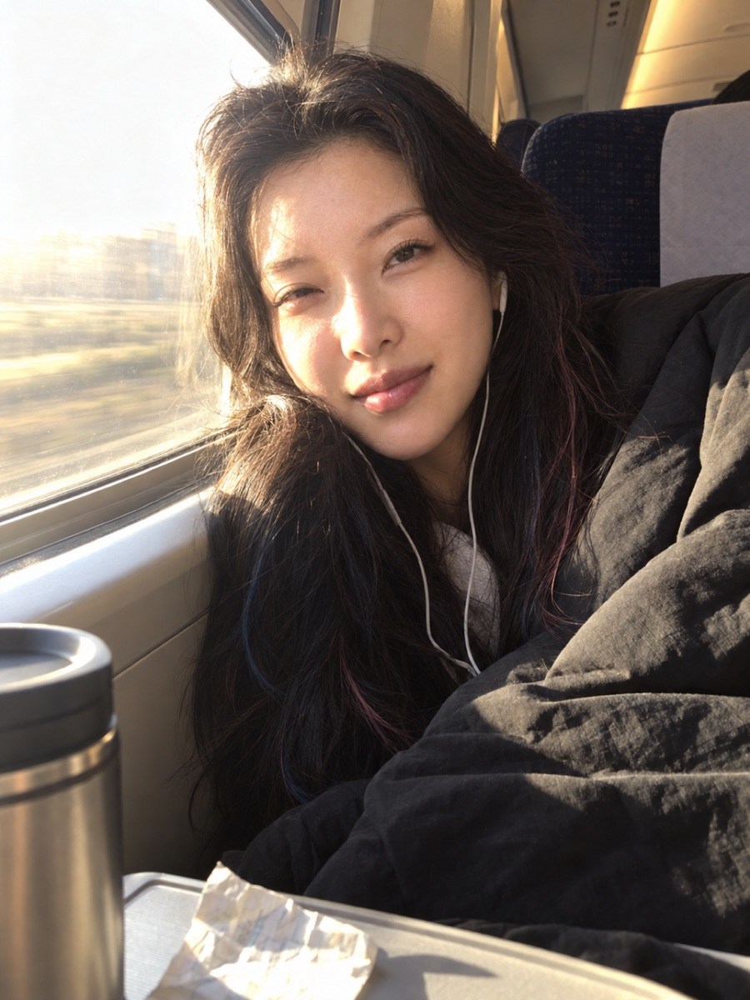
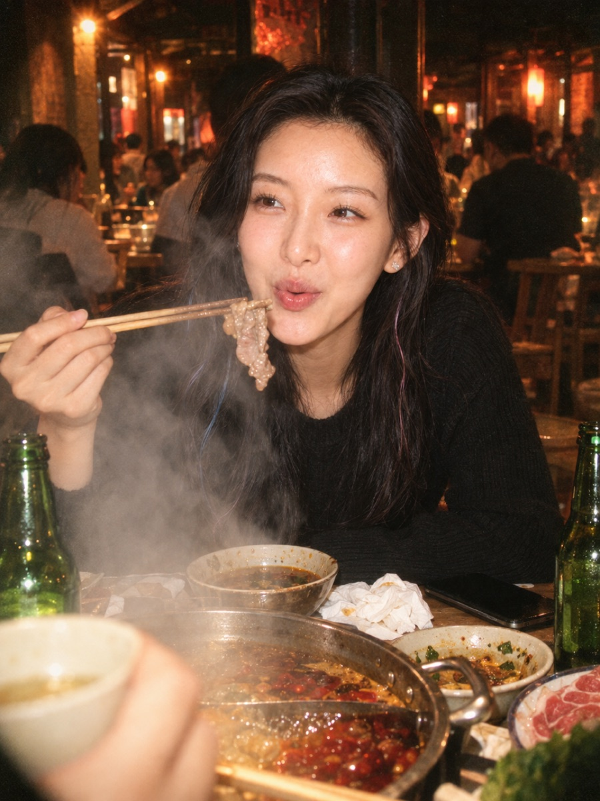
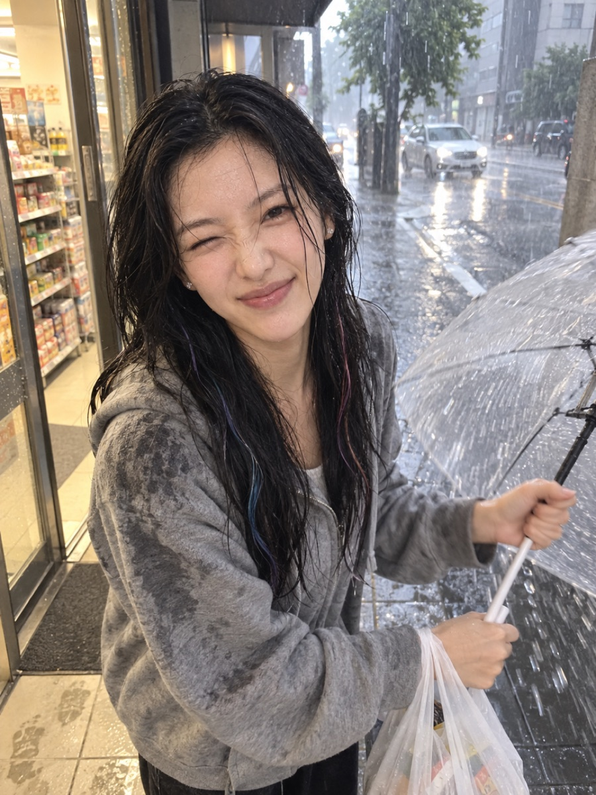
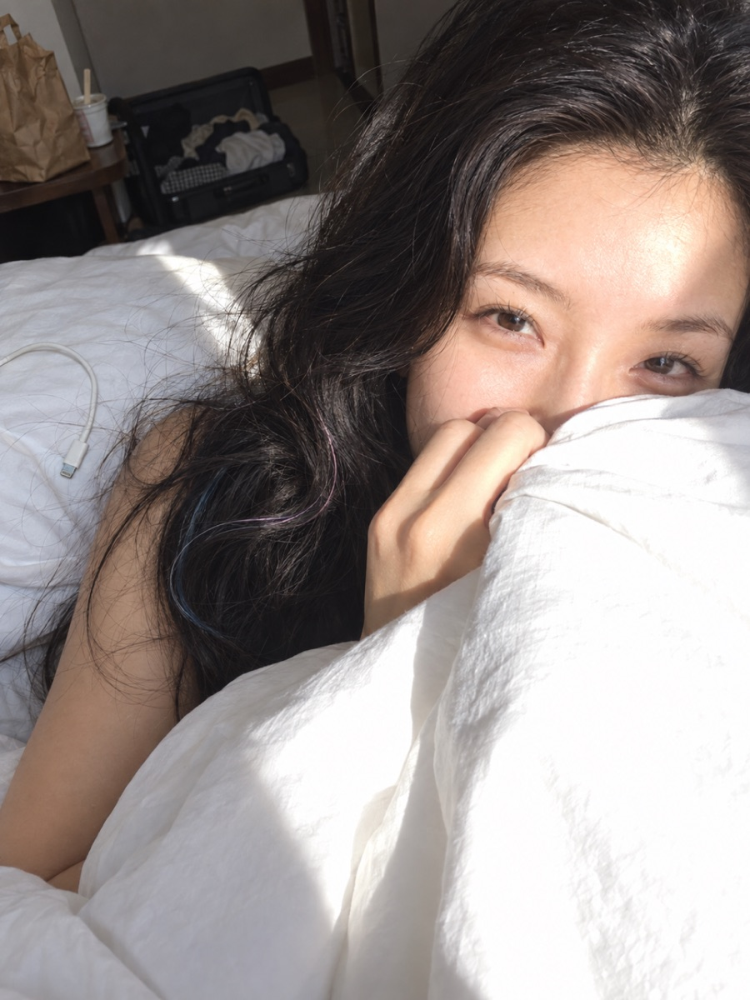
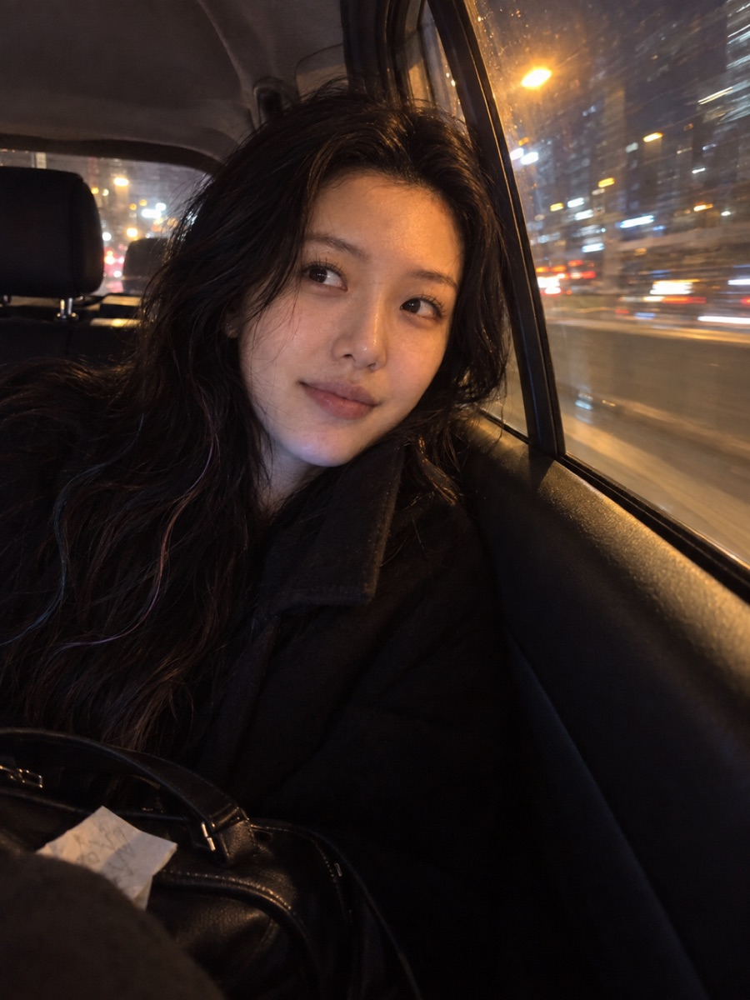
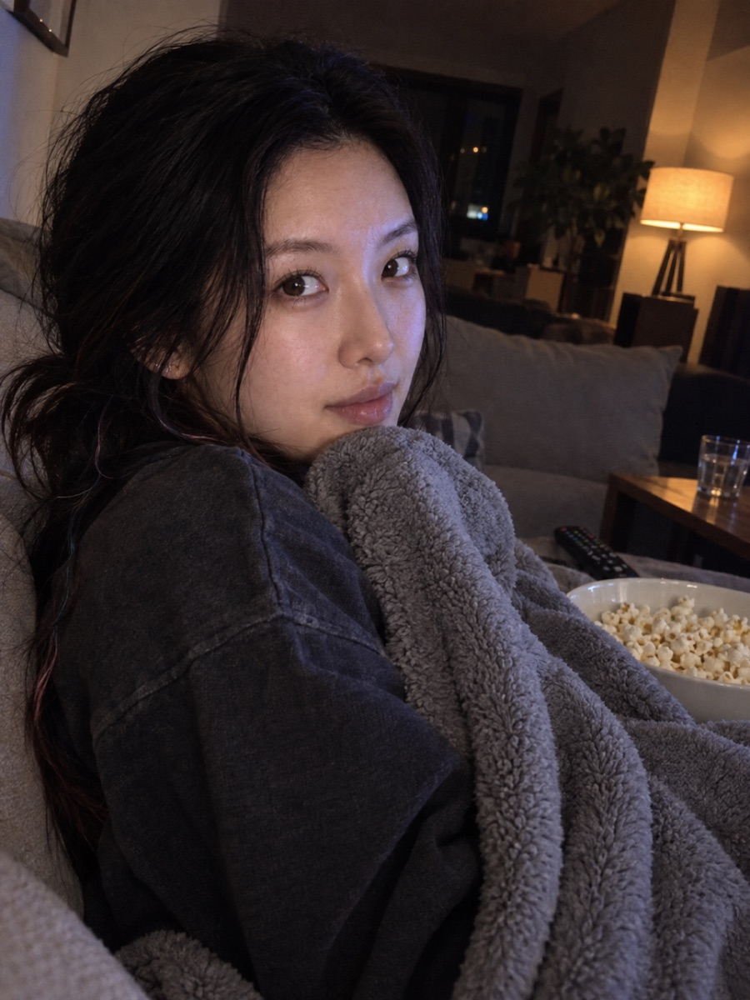
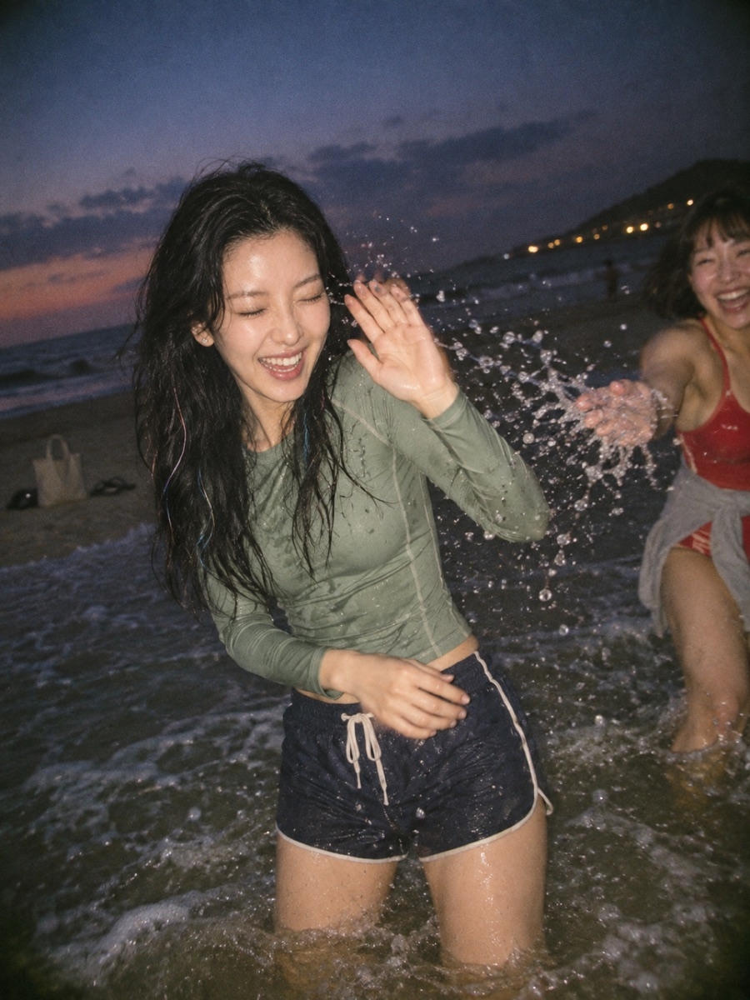
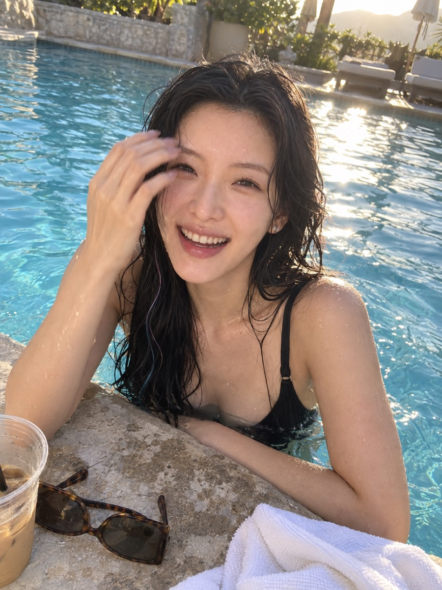
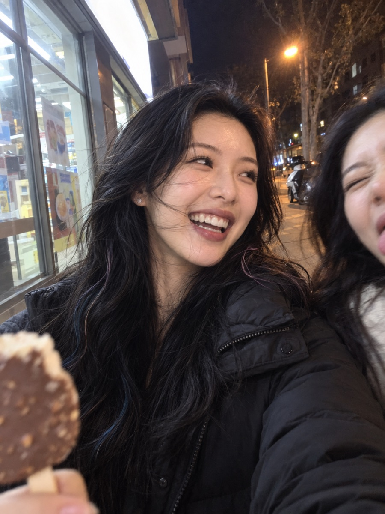
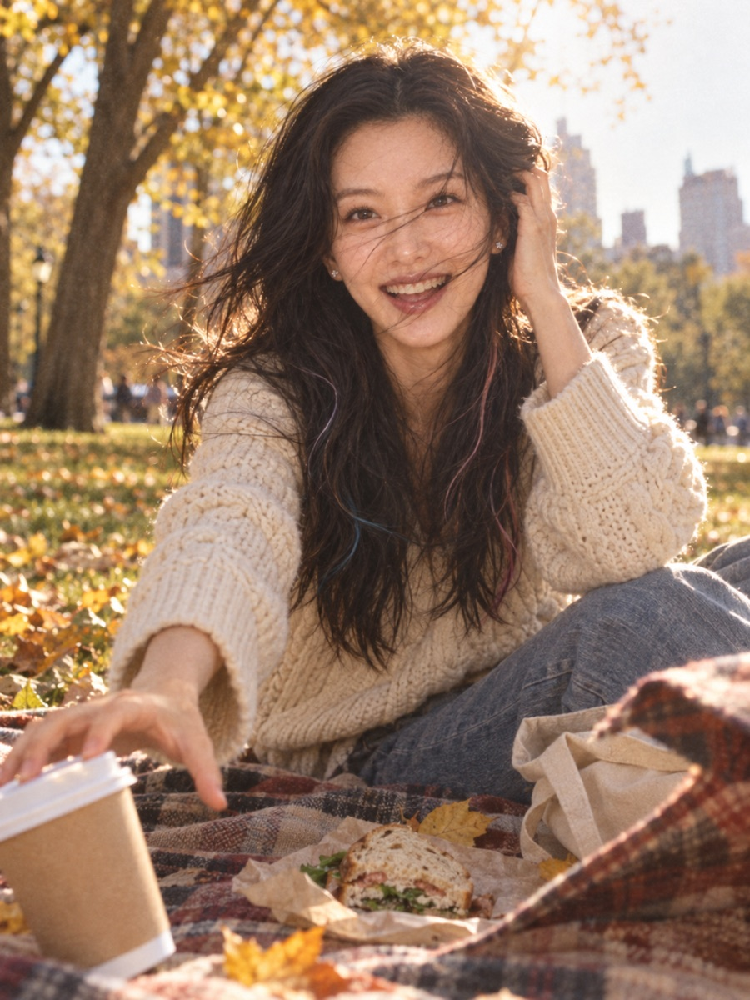

# Candid Photo Prompt

**让 AI 人像看起来像某个人手机相册里的一张照片，不是写真，也不是精修大片。**

一个给 Claude Code / Codex 用的 Agent Skill：给它一张你自己的人物头像，它会写出男友视角、朋友随手拍、iPhone 自拍、一次性相机闪光这类有人感的抓拍提示词，并调用你环境里的生图工具出图。

> 下面所有照片均为 **AI 生成**（OpenAI gpt-image-2），不是真实拍摄。同一个人物、一张正面头像做身份参考，场景全部由文字描述。

<p align="center">
  
  
  
</p>
<p align="center"><sub>清晨高铁 · 男友视角 iPhone ｜ 深夜火锅 · 一次性相机闪光 ｜ 雨天便利店 · 朋友随手拍</sub></p>

---

## 有多真实？

把这几张发到朋友圈，大概率没人会问“这是 AI 吗”。原因不在画质，而在这些细节：

- **有拍照的人**。刚被叫醒眯眼看男友、火锅桌对面朋友虚掉的碗、被朋友笑成落汤鸡后挤眼做鬼脸。每张图里都有一段“她和拍照的人之间”的关系。
- **光是现场的光**。高铁晨光把半张脸照过曝，火锅蒸汽在闪光灯里发白，便利店的暖光和雨天的冷光同时打在脸上。没有棚拍补光。
- **东西是被人放下的**。耳机线、保温杯、揉皱的车票；啤酒瓶、纸巾团、倒扣的手机；滴水的透明伞、塑料袋、湿脚印。
- **瑕疵有原因**。HDR 高光溢出、闪光暗角和颗粒、雨滴拖影、构图歪了几度，都是那台相机在那个现场会犯的错。
- **不是精修脸**。素颜、哑光嘴唇、被压扁的头发、湿发贴在额头上。参考图的棚拍精致感被刻意去掉，只保留五官和发型。

### 更多样图

<p align="center">
  
  
  
</p>
<p align="center"><sub>民宿早晨，他刚拉开窗帘 ｜ 深夜出租车，靠着车窗 ｜ 电影看到一半，“你拍我干嘛”</sub></p>

<p align="center">
  
  
  
</p>
<p align="center"><sub>海边傍晚被泼水 · 一次性相机 ｜ 刚从泳池探出头 · 男友视角 ｜ 便利店门口合拍 · 前置自拍（无参考图）</sub></p>

### 失败的样子也告诉你

<p align="center"></p>

秋日野餐这张是反例：撩头发的经典姿势、对镜头张嘴大笑、城市天际线、精心挑选的毛衣和道具。几样叠在一起，立刻变成生活方式广告图。Skill 里专门写了怎么避开。

---

## 核心方法：六句话写完一张图

1. **谁拍、用什么拍、从哪拍**：“她男友坐在旁边座位，用 iPhone 从胸口高度拍”
2. **正在发生的一件事**：“刚被叫醒”，不是“坐在高铁上”
3. **表情的原因**：“他叫了她的名字，所以眯眼看他，嘴角刚开始笑”
4. **一个主光源和它留下的痕迹**：“晨光扫过半张脸，窗外过曝成一片亮”
5. **两三件现场物件**：“有线耳机、保温杯、揉皱的车票”
6. **一两个有原因的不完美**：“HDR 让脸颊高光溢出，构图略歪、头顶被裁”

多轮实测和逐张打分得出的几条经验：

- 亲密的拍摄关系最有人感：男友近距离 > 朋友在场的热闹 > 单人对镜头做表情。
- 看镜头没问题，安静地只看拍照的那个人反而最强。
- 细节不要整表堆叠，每类只选一两个，堆多了反而更像精修图。
- 参考图的亮唇釉最容易漏进来，要明确写“素颜、哑光微干的嘴唇”。

完整写法见 [SKILL.md](skills/candid-photo-prompt/SKILL.md)，场景配方见 [scenes.md](skills/candid-photo-prompt/references/scenes.md)，样图的原始提示词见 [examples/prompts.md](examples/prompts.md)。

---

## 安装

**Claude Code**

```bash
git clone https://github.com/wuzihuang/candid-photo-prompt.git
cp -r candid-photo-prompt/skills/candid-photo-prompt ~/.claude/skills/
```

**Codex**

```bash
git clone https://github.com/wuzihuang/candid-photo-prompt.git
cp -r candid-photo-prompt/skills/candid-photo-prompt ~/.codex/skills/
```

其他支持 Agent Skills 的工具，把 `skills/candid-photo-prompt` 放进对应的 skills 目录即可。也可以不装，直接照 `examples/prompts.md` 的提示词改着用。

## 使用

准备一张**你自己的人物**正面清晰头像（本仓库不附带任何人物头像），然后对 Agent 说：

> 用这张头像，给我生成一张男友视角的清晨高铁抓拍。

> 帮我写一个“深夜便利店门口和朋友合拍”的提示词，一次性相机闪光那种，先不用生成。

生图需要你的环境里有可用的图像工具（如 Codex 内置 imagegen、gpt-image API、Gemini 等）。没有参考图也可以用，Skill 会用一句外貌描述代替身份段。

## 使用须知

- 所有人物一律为成年人。
- 请只使用你有权使用的人物形象，不要用来冒充真实的他人，也不要把生成图当作真实照片去误导别人。
- 生成结果因模型和随机性而异，单张好不代表每次都好。

## License

MIT
